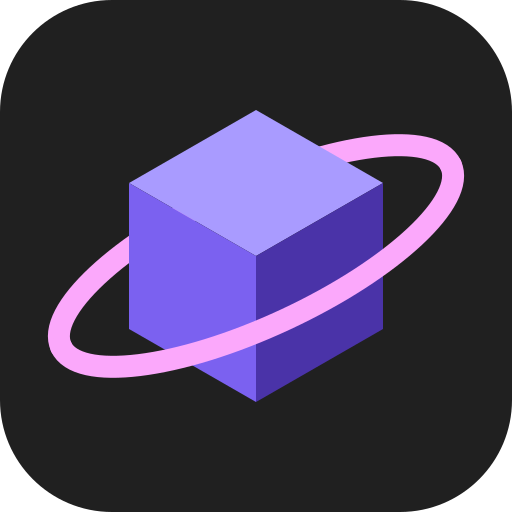

 <p align="center">
  
</p>

<h1 align="center">OrbMC</h1>

<p align="center"><a href="README.md">Russian</a> · English</p>

[](https://github.com/Incoderr/OrbMC/actions/workflows/checks.yml)
[](https://github.com/Incoderr/OrbMC/releases/latest)
[](LICENSE)


OrbMC is a fast, native Minecraft launcher written in Rust. Its interface is built with [GPUI](https://www.gpui.rs/), without Electron, WebView, or Node.js. Java is only required by the game itself; the launcher automatically installs the required version.

## Installation

Download `orbmc.exe` from the [latest release](https://github.com/Incoderr/OrbMC/releases/latest) and run it. No installer is required.

## Building from Source

Requires stable Rust 1.85 or later.

```bash
cargo build --release
```

The debug build (`cargo run`) includes the GPUI inspector. The `--no-default-features` flag disables it.

Optional build-time environment variables:

| Variable                  | Description                                                                          |
| ------------------------- | ------------------------------------------------------------------------------------ |
| `ORBMC_DISCORD_APP_ID`    | Discord application ID used to display the user's status                             |
| `ORBMC_UPDATE_PUBLIC_KEY` | minisign public key; without it, the launcher only notifies users about new versions |
| `CURSEFORGE_API_KEY`      | CurseForge API key (CurseForge integration is currently disabled)                    |

Releases are created using tags in the `vX.Y.Z` format, matching the version specified in `Cargo.toml`. The `release.yml` workflow builds, signs, and publishes the executable.

## Data

| Contents                                      | Location                                          |
| --------------------------------------------- | ------------------------------------------------- |
| Settings, instance list, and application data | `%LOCALAPPDATA%\OrbMC`                            |
| Launcher log                                  | `%LOCALAPPDATA%\OrbMC\logs\launcher.log`          |
| Minecraft instance files                      | `<downloads directory>\instances\<instance name>` |

When reporting a bug, attach `launcher.log`.

## Development

```text
app/     Application: features, UI, and OS integration
core/    Minecraft logic independent of the UI
vendor/  Modified copies of dependencies (see vendor/README.md)
```

Architecture and coding guidelines are documented in [`AGENTS.md`](AGENTS.md).

Run the following checks before committing:

```bash
cargo fmt --all
cargo clippy --workspace --all-targets -- -D warnings
cargo test --workspace
```

## License

[GPL-3.0](LICENSE). Dependencies in `vendor/` are distributed under their respective licenses. Minecraft is a trademark of Mojang AB. This project is not affiliated with Mojang or Microsoft.
